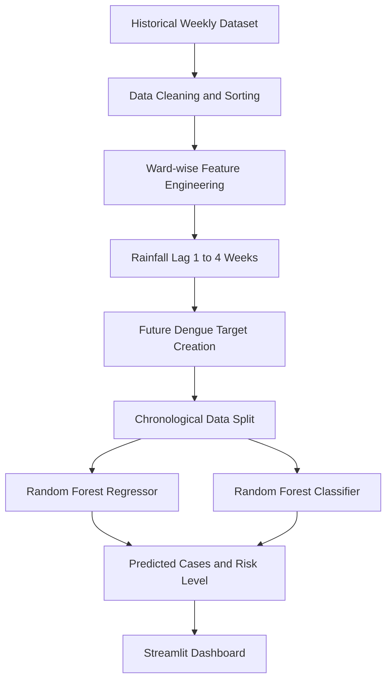

# DENGUARD AI — System Architecture

## 1. System Overview

DENGUARD AI is a ward-level dengue early-warning
prototype using historical weekly weather,
urban vulnerability and dengue case data.

The system predicts total dengue cases for
weeks 2, 3 and 4 after a selected week.

Target:

Y(t) = Cases(t+2) + Cases(t+3) + Cases(t+4)

## 2. Data Flow Diagram

## 3. Data Processing

Dataset characteristics:

- 31,320 weekly records
- 60 unique wards
- 5 cities
- Historical period: 2016–2025

Records are sorted by ward_id and date.

Rainfall lag features are generated separately
for each ward using grouped shifting.

Features include:

- Current rainfall
- Rainfall lag 1 week
- Rainfall lag 2 weeks
- Rainfall lag 3 weeks
- Rainfall lag 4 weeks
- Temperature and humidity
- Population density
- Waterlogging risk
- Sanitation score
- Current dengue cases
- Calendar month

## 4. Prediction Target

The regression model predicts:

Cases at week t+2
+ Cases at week t+3
+ Cases at week t+4

Future dengue cases are used only as training
targets, never as input features.

## 5. Chronological Validation Strategy

Random splitting is avoided because this is
a time-dependent prediction problem.

The dataset is separated chronologically:

- Training: up to 28 November 2022
- Validation: 2 January 2023 to 25 November 2024
- Testing: from 6 January 2025

Four-week separation gaps are maintained
between the periods to reduce overlap of
future target windows.

The training period is used for model fitting
and threshold calculation.

Validation is used for model evaluation
and selection.

The final test period is reserved for
unseen performance evaluation.

## 6. Model Selection Rationale

### Random Forest Regressor

Used to predict numerical dengue case burden.

Reasons:

- Learns nonlinear relationships
- Handles mixed numerical features
- Provides feature importance
- Supports local inference

A mean-based baseline was also evaluated.

### Random Forest Classifier

Used to predict four risk categories:

- Low
- Medium
- High
- Critical

Class weights are balanced to give
additional attention to less frequent classes.

Risk thresholds are calculated from
positive training-target quantiles:

- Low: zero cases
- Medium: above zero through the first threshold
- High: above the first through the second threshold
- Critical: above the second threshold

These are prototype thresholds, not official
public health alert definitions.

## 7. Model Evaluation

Regression metrics:

- MAE
- RMSE
- R² Score

Classification metrics:

- Accuracy
- Precision
- Recall
- F1-score
- Confusion Matrix

Final historical test results:

Regression:
- MAE: 2.90
- RMSE: 5.21
- R²: 0.77

Classification:
- Accuracy: 75.90%
- Macro F1: 0.71
- Critical Recall: 81%

## 8. Compute and API Cost Efficiency

The prototype uses local model inference.

- Trained models are serialized using Joblib.
- Models are loaded once using Streamlit caching.
- Dataset loading is cached.
- No unnecessary external API requests are made.
- No LLM is used in the prediction pipeline.
- LLM token cost is therefore zero.
- Prediction does not retrain the model.

This reduces execution time and recurring API costs.

## 9. Limitations and Future Improvements

Current limitations:

- Historical dataset ends on 29 December 2025.
- No live weather forecast integration.
- Risk thresholds are not official health thresholds.
- Geographic boundary data is not yet integrated.

Future improvements:

- Live weather forecast integration
- Ward-level geographic risk maps
- Confidence intervals
- Automated model monitoring
- More robust chronological validation
- Public health resource planning support
